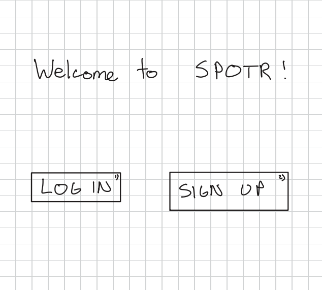
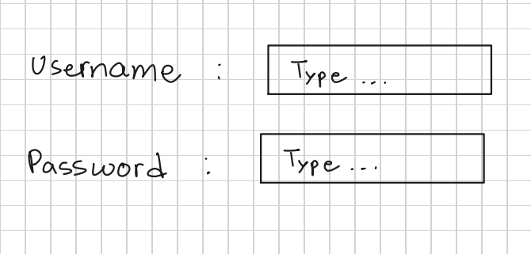
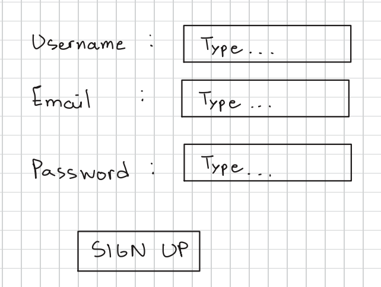
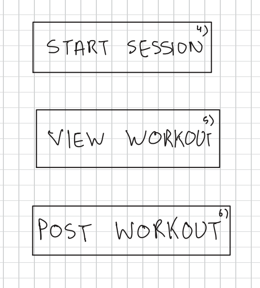
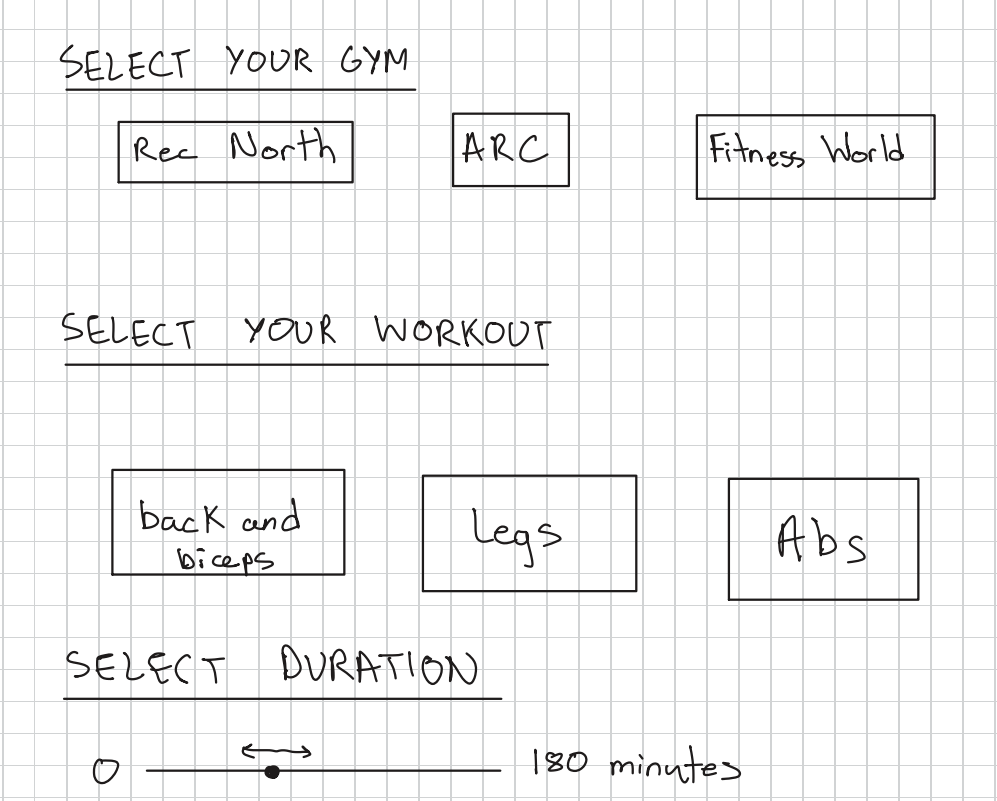
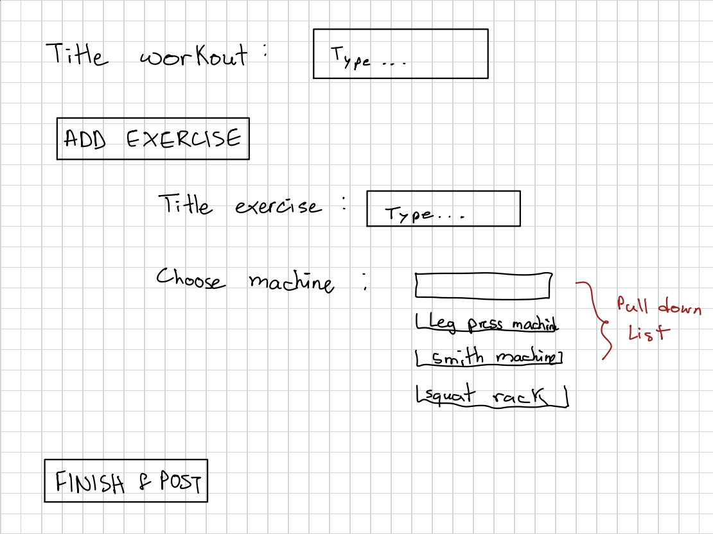
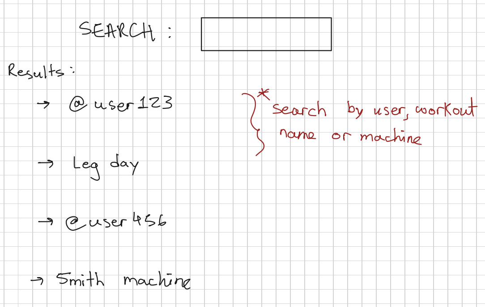

# Design Your Solution

## Problem

UBC's newly constructed Recreation North facility suffers from overcrowding. Google Maps shows that peak hours are between 5–9 PM daily. Between those hours, attendees find it difficult to find open machines and complete workouts in a reasonable time frame. This issue is reflected in reviews of the facility, with 8/27 reviews with descriptions mentioning long wait times, crowdedness, or insufficient number of machines.

Even outside of peak hours, the issues with finding machines persist. Overlaps in workout focus between gym goers can lead to high demand for specific machines/equipment, causing longer sessions even when the gym isn't particularly full. Popular machines which are prone to crowding include: seated chest fly, leg extension, leg press, seated incline press, etc. People often have to "work in" on these machines, alternating use with 2 or more people, which can extend workout sets.

Currently, there is no way for attendees to track how busy the gym is or which machines are in high demand to plan their workout times. This lack of information can exacerbate the existing crowding issues.

## Solution

Our vision for a solution is a website that allows gym goers to sign in when they are starting a workout. It would prompt users to select their gym, workout type, and duration. This would allow us to track not only how busy each gym is, but also which machines are in high demand. Since attendance is dynamic, we would also need to track workout length. This would allow us to dynamically predict how busy the gym will be in the future.

### Welcome page

When users open the website, users will be prompted to either log in or sign up:

### Log in and Sign up

After selecting between those options, they will be redirected to one of two pages. Both pages would require touch and keyboard support for users to type.

### Main landing page

The main landing page would have three large buttons for users to pick from: view workout, start session, and post workout. The start session page can either act as a basic check in, or an in depth tracker depending on the user's needs.

The create workout button would redirect to a page where users can build a personalized workout, selecting the specific exercises and duration. Once that is complete, the workout will be available for selection when they click start session. This would not be mandatory for users that just want to check in and check out of the gym.

### Start session

The interface for the start session page would be incredibly minimal. Three buttons at the top of the screen for users to select their gym, a scrollable list of blocks for users to select their workout from workouts they have created, and a slider for them to pick a duration from 0–180 minutes. If a user has not created workouts, the select workout section would not be present, just allowing them to pick a gym and a duration. After starting the workout, the app would start a timer and add the user to the list of gym attendees at that time. It would also take workout duration into account to update the traffic prediction and display for others.

### Post workout

Beyond basic check in capabilities the platform would allow users to create workouts for themselves or other users to follow. That is the function of the post workout button on the main landing page. It would redirect users to a page where they can title a custom workout and select the corresponding exercises. This page would also require keyboard support.

### Search

After pressing post, other users would be able to choose from those workouts by searching. If a user finds a workout they like, they would then be able to select them when starting a session. This is the last page that would require keyboard support.

