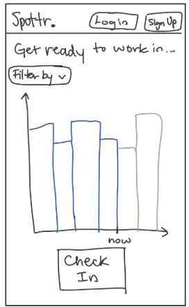
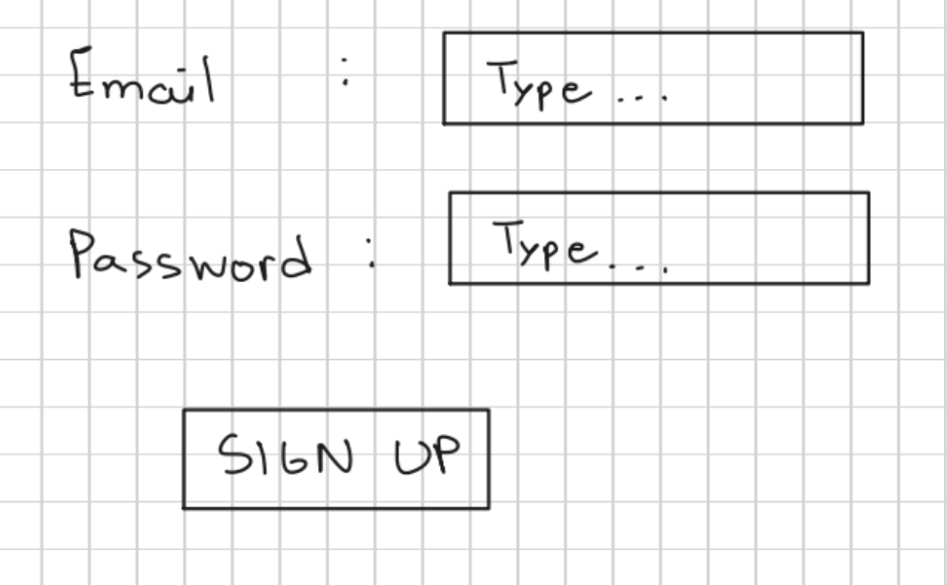
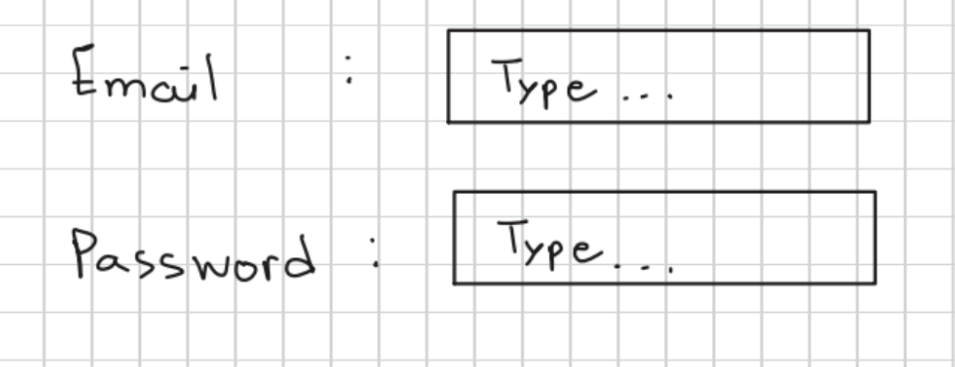
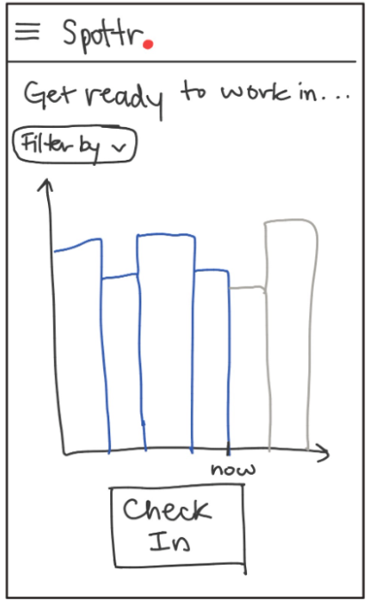
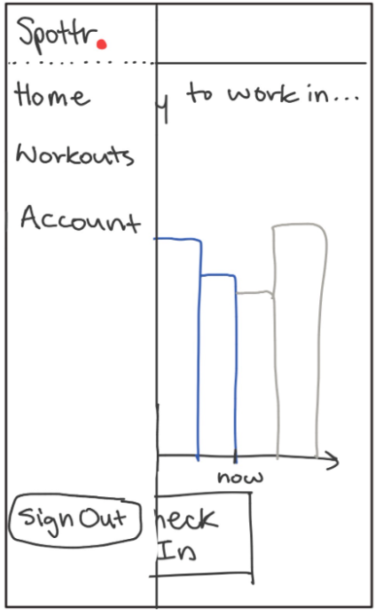
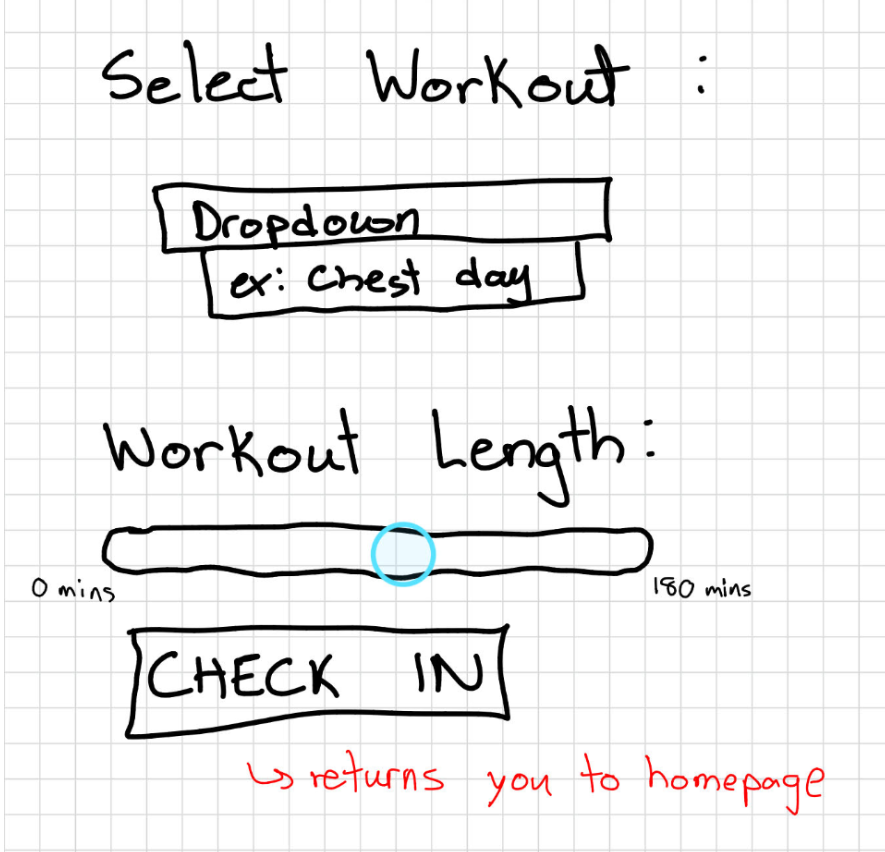
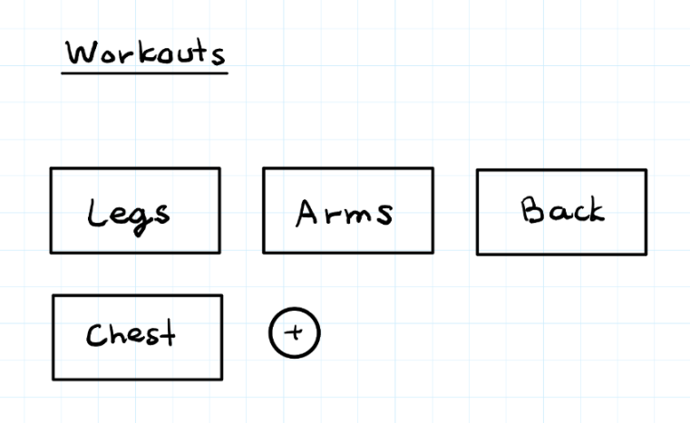
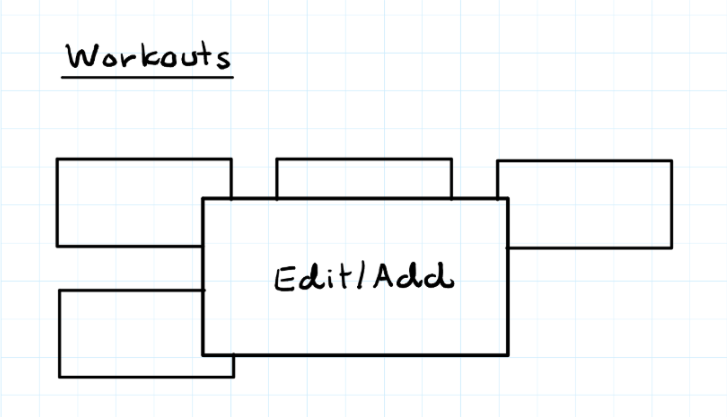
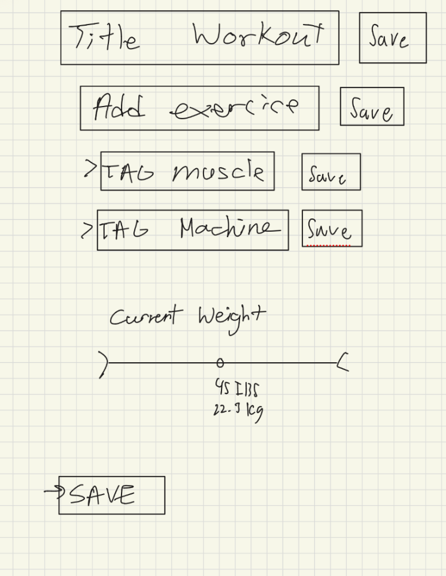

# spottr

## Team Roles

| Role | Member(s) |
|------|-----------|
| Project Manager | Mofe Omolade |
| Designer | Lisa Tir |
| Developers | Natasha Mykytiuk, Marko Ivanovski, Ralu Chineme |

## Team Name + Mission

**Group Name:** Git Fit

**Goal:** Make going to the gym less intimidating for beginners, and more convenient for regulars. We want more students to feel comfortable going to the gym and promote fitness and health, as well as community and mentorship in the fitness space.

**Overarching Values:** Accessibility, Fitness, Community, Education

**Slogan:** *Skip the wait, not the weights*

**Mission Statement:** In pursuit of a healthier UBC

## Problem Statement

The recent opening of Recreation North has motivated students all over campus to join the gym community. However, it has inadvertently reinforced UBC's "busy gym" problem. Despite 4 floors of accessible equipment, wait times have increased and the ability to use the machines you need has decreased. This has increased gym anxiety among beginners and frustration among regulars.

Many new gym members already face barriers like learning how to use the gym equipment and how to orient themselves in the fitness space. Busy gyms make those difficulties feel much heavier.

Right now, the only ways to check how busy the gym is or which machines are available are going to see for yourself or asking a friend, which can be quite inconvenient. Leaving the choice of when to go to the gym up to guesswork can considerably extend a session. That isn't an option for busy people trying to stay active in the little free time they have.

# Design Your Solution

## Problem

UBC's newly constructed Recreation North facility suffers from overcrowding. Google Maps shows that peak hours are between 5–9 PM daily. Between those hours, attendees find it difficult to find open machines and complete workouts in a reasonable time frame. This issue is reflected in reviews of the facility, with 8/27 reviews with descriptions mentioning long wait times, crowdedness, or an insufficient number of machines.

Even outside of peak hours, the issues with finding machines persist. Overlaps in workout focus between gym-goers can lead to high demand for specific machines/equipment, causing longer sessions even when the gym isn't particularly full. Popular machines which are prone to crowding include: seated chest fly, leg extension, leg press, seated incline press, etc. People often have to "work in" on these machines, alternating use with 2 or more people, which can extend workout sets.

Currently, there is no way for attendees to track how busy the gym is or which machines are in high demand to plan their workout times. This lack of information can exacerbate the existing crowding issues.

## Solution

Our vision for a solution is a website that allows gym-goers to sign in when they are starting a workout. It would prompt users to select their gym, workout type, and duration. This would allow us to track not only how busy each gym is, but also which machines are in high demand. Since attendance is dynamic, we would also need to track workout length. This would allow us to dynamically predict how busy the gym will be in the future and how busy specific machines are.

### Home page

When users open the website, they will be able to view a graph of the Rec North busy scale, a dropdown to filter through the data by muscle group, and sign-up/login buttons in the top bar. Check-in and Filter By redirect the user to the sign-up page if they are not an authenticated user.

### Sign up and Log in

After selecting between those options, they will be redirected to one of two pages. Both pages would require touch and keyboard support for users to type.

### Main page (after sign up or log in)

The main page after sign up or log in would have the same landing page graph, except this time users can filter through muscle groups or machines (using the dropdown above the graph) to view different analytics graphs for business per filter. A check-in button is located below the graph, and a sidebar menu icon is located on the top left of the page. This menu opens up to a Create Workout button, View Workouts, and a button to return to the home page (where check-in is located).

### Create workout

The Create Workout button would redirect to a page where users can build a personalized workout, selecting the specific exercises and duration. Once that is complete, the workout will be available for selection when they click Start Session. This would not be mandatory for users who just want to check in and check out of the gym.

### Check-in

The interface for the check-in page would be incredibly minimal. This would include a scrollable list (dropdown) of blocks for users to select their workout from workouts they have created, and a slider for them to pick a duration from 0–180 minutes. If a user has not created workouts, the select workout section would be empty, just allowing them to pick a duration. After starting the workout, the app would start a timer and add the user to the list of gym attendees at that time. It would also take workout duration into account to update the traffic prediction and display for others.

### Workouts

Beyond basic check-in capabilities, the platform would allow users to create workouts and add an exercise that they can return to for the next workout. The TAG muscle and TAG Machine button is used for the program to determine how busy a station or muscle group being worked is. They can then select the current weight interface that allows the user to track their progress with certain machines. Below are two concepts of how to design this. This would require keyboard capability.

